# SMART PHARMACY INVENTORY AND MEDICINE WASTE MANAGEMENT SYSTEM

**A mini project report submitted in partial fulfilment of the requirement for the award of the degree of**

### BACHELOR OF TECHNOLOGY
**in**
### COMPUTER SCIENCE AND ENGINEERING

---

**Submitted by:**

| Name of the Student | Roll Number |
|---|---|
| **[Student Name 1]** | [Roll No. 1] |
| **[Student Name 2]** | [Roll No. 2] |
| **[Student Name 3]** | [Roll No. 3] |
| **[Student Name 4]** | [Roll No. 4] |

---

**Under the Esteemed Guidance of**
### CH. BHANU KUMAR
**Assistant Professor**

<br>

<div align="center">
  
</div>

<br>

### DEPARTMENT OF COMPUTER SCIENCE AND ENGINEERING
### ENGINEERING AND TECHNOLOGY PROGRAM
### GAYATRI VIDYA PARISHAD COLLEGE FOR DEGREE AND PG COURSES (A)
**Rushikonda, Visakhapatnam – 45**  
*(Approved by AICTE | Accredited by NBA | Accredited by NAAC | Affiliated to Andhra University | An ISO 9001:2015 Certified Institution)*  
**Academic Year: 2025–2026**

\newpage

---

# DEPARTMENT OF COMPUTER SCIENCE AND ENGINEERING
### GAYATRI VIDYA PARISHAD COLLEGE FOR DEGREE AND PG COURSES (A)
**Rushikonda, Visakhapatnam – 45**

<br>

<div align="center">
  
</div>

<br>

## CERTIFICATE

This is to certify that the project report entitled **"SMART PHARMACY INVENTORY AND MEDICINE WASTE MANAGEMENT SYSTEM"** being submitted by **[Student Name 1] ([Roll No. 1]), [Student Name 2] ([Roll No. 2]), [Student Name 3] ([Roll No. 3]), [Student Name 4] ([Roll No. 4])** in partial fulfilment for the award of the Degree of **Bachelor of Technology in Computer Science and Engineering** to the Gayatri Vidya Parishad College for Degree and PG Courses (A), Visakhapatnam is a record of bonafide work carried out under my guidance and supervision.

<br><br><br>

**Project Guide:**  
**CH. BHANU KUMAR**  
Assistant Professor  
Department of CSE  

<br><br>

**Head of the Department:**  
**Dr. N. V. RAMANA MURTHY**  
Professor & Head of the Department  
M.Tech, Ph.D  
Department of CSE  

<br><br>

**External Examiner:**  
*(Signature & Date)*

\newpage

---

## VISION AND MISSION OF THE INSTITUTE

### VISION
> **"Creating Human Excellence for a Better Society"**

### MISSION
> **"Unfold into a World class organization with strong academic and research base, producing responsible citizens to cater to the changing needs of the society."**

<br>

---

## VISION AND MISSION OF THE DEPARTMENT

### VISION
> **"Create and sustain as a Centre of excellence in Computer Science and Engineering and allied areas of research to pave the way for providing better technocrats to the society."**

### MISSION
> **"To provide strong conceptual base (M1) for acquiring programming skills, to develop high computational innovative skills (M2) and to empower leadership qualities with strong ethical base (M3)."**

\newpage

---

## PROGRAM EDUCATIONAL OBJECTIVES (PEOs)

* **PEO1:** Ability to develop hardware and software problem-solving capabilities by inculcating strong fundamental, analytical, and communication skills.
* **PEO2:** Ability to build confidence to address the challenges in their work and to apply innovative technical tools through interaction with professional bodies.
* **PEO3:** Ability to gain sufficient depth of knowledge, self-learning skills, technical skills, and leadership qualities through participating in personality development activities, so as to sustain in a multidisciplinary environment.
* **PEO4:** To be able to respond to societal needs in professional and ethical concerns.

---

## PROGRAM SPECIFIC OUTCOMES (PSOs)

* **PSO 1: System Inception and Elaboration:** Conceptualize software and/or hardware systems, system components, and processes/procedures through requirement analysis, modeling/design of the system using architectural/design patterns, standard notations, procedures, and algorithms.
* **PSO 2: System Construction:** Implement the systems, procedures, and processes using state-of-the-art technologies, standards, tools, and programming paradigms.
* **PSO 3: System Testing and Deployment:** Verify and validate the systems, procedures, and processes using various testing and verification techniques and tools.
* **PSO 4: Quality and Maintenance:** Manage the quality through various product development strategies under revision, transition, and operation through maintainability, flexibility, testability, portability, reusability, interoperability, correctness, reliability, efficiency, integrity, and usability to adapt the system to the changing structure and behavior of the systems/environments.

\newpage

---

## DECLARATION

We hereby declare that the project entitled **"SMART PHARMACY INVENTORY AND MEDICINE WASTE MANAGEMENT SYSTEM"** submitted in partial fulfilment of the requirements for the award of **Bachelor of Technology in Computer Science and Engineering**, to Engineering and Technology Program, Gayatri Vidya Parishad College for Degree & PG Courses (A), is an authentic record of our own work carried out under the supervision of **CH. BHANU KUMAR**, Assistant Professor. We assure that this project is not submitted in any other University or College for the award of any degree or diploma.

<br><br>

**Name & Signature of the Students:**

1. **[Student Name 1] ([Roll No. 1])** — ___________________
2. **[Student Name 2] ([Roll No. 2])** — ___________________
3. **[Student Name 3] ([Roll No. 3])** — ___________________
4. **[Student Name 4] ([Roll No. 4])** — ___________________

<br>
**Place:** Visakhapatnam  
**Date:** 31-10-2026

\newpage

---

## ACKNOWLEDGEMENT

With great pleasure, we take this opportunity to express our heartfelt gratitude to all the people who helped in making our mini project work a grand success.

First of all, we express our deep sense of gratitude to our project guide **Sri. CH. BHANU KUMAR**, Assistant Professor, for his constant guidance, constructive suggestions, and keen encouragement throughout our mini project work.

We would like to express our gratitude to **Dr. N. V. RAMANA MURTHY**, Professor and Head of the Department of Computer Science and Engineering, for providing necessary infrastructural facilities and moral support throughout the period of our study.

We express our sincere thanks to our Principal and the Management of **Gayatri Vidya Parishad College for Degree and PG Courses (A)** for providing an academic environment conducive to the successful completion of this project.

We would like to thank all the **Teaching and Non-Teaching Staff** of the Department of Computer Science and Engineering for sharing their valuable knowledge, technical insights, and assistance.

Finally, we express our sincere thanks to our **Parents and Friends** who directly or indirectly supported and motivated us to complete this project successfully.

<br><br>
**Project Associates:**
* **[Student Name 1] ([Roll No. 1])**
* **[Student Name 2] ([Roll No. 2])**
* **[Student Name 3] ([Roll No. 3])**
* **[Student Name 4] ([Roll No. 4])**

\newpage

---

## ABSTRACT

In modern healthcare infrastructure, efficient inventory control and timely disposal of pharmaceutical waste are paramount to patient safety, financial sustainability, and legal compliance. Traditional pharmacy systems frequently rely on manual paper registers or generic spreadsheets, which are error-prone, lack real-time batch tracking, fail to actively prevent dispensing expired medicines, and do not provide transparent accounting for damaged or expired pharmaceutical waste.

The **Smart Pharmacy Inventory and Medicine Waste Management System** is a robust, lightweight, full-stack web application developed using **Python, Flask, SQLite, HTML5, CSS3/Bootstrap 5, and JavaScript**. The system introduces strict **role-based portal access** differentiating between **Administrators** (who oversee master medicine catalogues, inventory batch creation, system analytics, and audit reports) and **Pharmacists** (who manage operational transactions including purchases, sales, and hazardous medicine waste write-offs).

Key technical contributions of the platform include:
1. **Batch-Level Inventory Tracking:** Tracking medicines down to individual manufacturing and expiry dates, purchase prices, and selling prices.
2. **Automated Status Lifecycle:** Dynamic real-time categorization into *Available*, *Near Expiry* (within 30 days), *Low Stock* (based on configurable reorder levels), *Out of Stock*, and *Expired*.
3. **Strict Business Integrity Rules:** Systematic restriction preventing the sale of expired drugs or quantities exceeding on-hand stock, backed by atomic ACID transactions (`BEGIN IMMEDIATE ... COMMIT/ROLLBACK`).
4. **Structured Medicine Waste Accounting:** Dedicated waste disposal workflows requiring categorized reasons (*Expired*, *Damaged*, *Recalled*, *Other*) that adjust inventory without deleting audit history.
5. **Admin Sales Intelligence:** An integrated **Sales Count per Medicine** analysis module that correlates transactions with master inventory, displaying sales transaction volume, units sold, and total revenue per medicine with CSV export capabilities.
6. **Robust Application Security:** Server-side CSRF protection, session integrity, cryptographic password hashing via Werkzeug, and strict SQL parameterization.

Automated verification with **61 unit and integration test cases** confirms that the platform provides reliable, secure, and user-friendly automation for academic institutions, community dispensaries, and clinical pharmacies.

\newpage

---

## TABLE OF CONTENTS

| Chapter No. | Title | Page No. |
|---|---|---|
| | **Certificate** | 2 |
| | **Vision and Mission of Institute & Department** | 3 |
| | **PEOs and PSOs** | 4 |
| | **Declaration** | 5 |
| | **Acknowledgement** | 6 |
| | **Abstract** | 7 |
| **1.** | **INTRODUCTION** | **10** |
| | 1.1 Overview of Smart Pharmacy System | 10 |
| | 1.2 Importance of Pharmacy Inventory & Waste Management | 10 |
| | 1.3 Objectives of the Platform | 11 |
| | &emsp; 1.3.1 Scope of the Project | 11 |
| | &emsp; 1.3.2 Benefits to Pharmacists, Administrators, and Health Facilities | 11 |
| | &emsp; 1.3.3 Summary of Introduction | 12 |
| **2.** | **LITERATURE SURVEY** | **13** |
| | 2.1 Existing Pharmacy & Inventory Systems | 13 |
| | 2.2 Technologies Used in Similar Systems | 13 |
| | 2.3 Gaps in Existing Systems | 14 |
| | 2.4 Comparison of Platforms (Features vs Limitations) | 14 |
| **3.** | **REQUIREMENTS AND ANALYSIS** | **15** |
| | 3.1 Existing System | 15 |
| | 3.2 Proposed System | 15 |
| | 3.3 Functional Requirements | 16 |
| | &emsp; 3.3.1 Functional Modules | 16 |
| | &emsp; 3.3.2 Use Case Specifications | 17 |
| | 3.4 Non-Functional Requirements | 18 |
| | &emsp; 3.4.1 Software & Hardware Specifications | 18 |
| | 3.5 Analysis | 19 |
| | &emsp; 3.5.1 Functional Analysis | 19 |
| | &emsp; 3.5.2 Use Case Analysis | 19 |
| | &emsp; 3.5.3 Data Modeling (Entity Definitions) | 20 |
| | &emsp; 3.5.4 Advantages of the Analysis Phase | 21 |
| | &emsp; 3.5.5 Limitations Identified | 21 |
| **4.** | **SYSTEM DESIGN** | **22** |
| | 4.1 Design Goals | 22 |
| | 4.2 System Architecture (Three-Tier Architecture) | 23 |
| | 4.3 UML Diagrams | 24 |
| | 4.4 Use Case Diagram | 24 |
| | 4.5 Class Diagram | 26 |
| | 4.6 Activity Diagram | 28 |
| | 4.7 Sequence Diagrams | 29 |
| **5.** | **IMPLEMENTATION** | **31** |
| | 5.1 Technology & Coding Approach | 31 |
| | 5.2 Database & Information Handling | 32 |
| | 5.3 Programming Style | 33 |
| | 5.4 Verification and Validation | 33 |
| | 5.5 Implementation of Project Modules | 34 |
| **6.** | **TESTING** | **36** |
| | 6.1 Testing Activities | 36 |
| | 6.2 Testing Types | 36 |
| | 6.3 Test Cases (Automated & Verification Suite) | 37 |
| **7.** | **RESULTS & DEMONSTRATION** | **40** |
| | 7.1 Role-Based Authentication & Portal Selection | 40 |
| | 7.2 Administrator Dashboard & Sales Count per Medicine | 41 |
| | 7.3 Medicine Catalogue & Batch Management | 42 |
| | 7.4 Pharmacist Sales & Purchase Processing | 43 |
| | 7.5 Medicine Waste Write-off & Disposal Log | 44 |
| | 7.6 Dynamic Reporting & Secure CSV Export | 45 |
| **8.** | **SAMPLE CODE** | **46** |
| | 8.1 Core Application Controller (`app.py`) | 46 |
| | 8.2 Database Layer & Atomic Transaction Context (`database.py`) | 48 |
| | 8.3 Business Service Layer (`inventory_service.py`, `report_service.py`) | 49 |
| | 8.4 User Interface Architecture (`templates/login.html`) | 51 |
| **9.** | **CONCLUSION** | **53** |
| **10.** | **REFERENCES** | **54** |

\newpage

---

# CHAPTER 1: INTRODUCTION

### 1.1 Overview of Smart Pharmacy System
The **Smart Pharmacy Inventory and Medicine Waste Management System** is a computerized web platform engineered to eliminate inaccuracies, operational delays, and regulatory hazards in pharmacy storage and dispensing. At its core, the application automates inventory control at a granular batch level, monitors stock consumption, tracks medicine lifecycles, and maintains an uncompromised audit trail of every purchase, dispensing transaction, and waste write-off.

Unlike generic point-of-sale (POS) systems, pharmaceutical inventory demands strict compliance with healthcare safety standards. Medications from different production batches possess unique manufacturing dates, expiration timelines, supplier costs, and retail prices. Dispensing expired or degraded medicine can cause severe patient harm, while failing to identify near-expiry batches leads to unnecessary capital loss. The Smart Pharmacy System addresses these issues by embedding real-time automated status indicators (*Available*, *Near Expiry*, *Low Stock*, *Out of Stock*, *Expired*) directly into clinical and management workflows.

### 1.2 Importance of Pharmacy Inventory & Waste Management
Inventory is typically the largest financial asset in healthcare institutions, hospital pharmacies, and retail chemists. However, pharmacy inventory management is fraught with distinct operational vulnerabilities:
1. **Critical Expiration Dates:** Medications have strictly bounded therapeutic lifespans. Once expired, they become chemical hazards that must be quarantined and destroyed under biohazard protocols.
2. **Preventing Accidental Dispensing:** In high-volume dispensing environments, manual human inspection can fail, resulting in dispensing expired medication to patients.
3. **Financial Capital Preservation:** Drugs nearing expiry must be surfaced early to allow priority rotation (First-Expiry-First-Out / FEFO) or supplier return before turning into total losses.
4. **Transparent Waste Accountability:** Expired, broken, recalled, or degraded medications cannot simply vanish from records. They require strict accountability to prevent illicit drug diversion or pilferage.

By replacing manual paper ledgers with automated relational storage, the system ensures complete inventory visibility and accountability.

### 1.3 Objectives of the Platform
The primary aim of the Smart Pharmacy System is to maximize stock precision, accelerate dispensing, eliminate manual errors, and enforce pharmaceutical waste accountability.

Key specific objectives include:
* **Centralized Medicine Catalogue:** Maintain complete drug master details (brand name, therapeutic category, manufacturer).
* **Batch-Wise Multi-Inventory:** Support multiple concurrent batches for a single medicine, tracking separate expiration dates and purchase/selling price tiers.
* **Proactive Clinical Alerts:** Real-time flagging of batches that are near expiry (within 30 days) or below configurable reorder thresholds.
* **Enforced Business Rules:** Block any attempt to sell expired medication or quantities exceeding verified on-hand stock.
* **Immutable Audit Trails:** Disallow manual modification of stock numbers; all stock changes occur strictly via verifiable purchases, sales, or recorded waste.
* **Role-Differentiated Access:** Dedicated portals and navigation for Administrators and Pharmacists.
* **Management Analytics:** Provide dynamic reports (current stock, sales count per medicine, waste summaries) exportable to CSV.

#### 1.3.1 Scope of the Project
* **In Scope:** Role authentication (Admin and Pharmacist); master medicine registry; batch inventory tracking; automated status calculation; purchase processing; sales dispensing; waste recording with justification; comprehensive reporting and CSV export; sales count intelligence; responsive web layout.
* **Out of Scope:** Multi-branch central warehouse synchronization; patient clinical health records; digital barcode hardware integration; payment gateway gateways; customer-facing eCommerce.

#### 1.3.2 Benefits to Pharmacists, Administrators, and Health Facilities
* **To Pharmacists:**
  * Instant real-time stock lookup prevents physical shelf searches.
  * System prevents accidental sales of expired batches.
  * Simple, quick-entry forms for recording daily sales and receipts.
* **To Administrators & Management:**
  * Real-time visibility into overall store value and units on hand.
  * Immediate notification of critical low-stock items to avoid stockouts.
  * Dedicated **Sales Count per Medicine** metrics to identify best-selling products and optimize reorder levels.
* **To Healthcare Facilities & Patients:**
  * Ensures 100% compliance with medication safety.
  * Prevents financial leakage through structured disposal auditing.

#### 1.3.3 Summary of Introduction
The Smart Pharmacy Inventory and Medicine Waste Management System bridges the gap between manual record-keeping and complex enterprise resource planning (ERP) systems. Built on Python Flask and SQLite, it offers an efficient, verifiable, and secure solution for medical inventory tracking.

\newpage

---

# CHAPTER 2: LITERATURE SURVEY

### 2.1 Existing Pharmacy & Inventory Systems
Over the past decade, healthcare logistics has shifted from physical logbooks to automated digital solutions:
1. **Paper-Based Register Books:** Traditional small clinics and dispensaries log medicines in physical books. Every sale requires manual subtraction, and expiry dates are noted by hand.
2. **Generic Spreadsheet Software (e.g., Microsoft Excel):** Spreadsheets provide basic digital storage and formulas. However, they lack multi-user concurrency controls, role permissions, automated expiry warnings, and relational constraints.
3. **Enterprise Hospital ERPs (e.g., SAP Healthcare, Epic Willow):** Comprehensive platforms designed for massive hospital networks. While functional, they require extensive server infrastructure, substantial license fees, and complex employee training, making them impractical for standard academic clinics or standalone pharmacies.

### 2.2 Technologies Used in Similar Systems
Modern software engineering utilizes various architectural patterns for information management:
* **Presentation Tier:** HTML5, CSS3, JavaScript, and Bootstrap frameworks enable responsive, cross-device interfaces without requiring dedicated mobile software.
* **Application Tier:** Python (Flask/Django) or Node.js (Express) provides RESTful controllers, session validation, and service-based business processing. Flask is widely favored for its clean architectural footprint and rapid execution.
* **Database Management:** Relational engines (SQLite, PostgreSQL, MySQL) enforce relational constraints, foreign keys, and atomic transactions, ensuring data integrity. SQLite is an ideal self-contained engine for local, zero-configuration deployments.

### 2.3 Gaps in Existing Systems
A review of current solutions reveals several persistent limitations:
* **Absence of Batch-Level Granularity:** Many entry-level retail systems track only total item counts, blending batches with different expiry dates together.
* **Unrestricted Quantity Overwriting:** Standard inventory spreadsheets allow users to edit stock quantities directly, destroying the historical audit trail.
* **Neglected Waste Disposal Tracking:** Most POS platforms focus solely on sales revenue, providing no dedicated mechanism to document expired or damaged inventory write-offs.
* **Lack of Direct Expiry Interlocking:** Existing software may display an expiry date but fails to hard-block sales if an operator selects an expired batch.
* **Complex UI:** High-end ERPs suffer from cluttered interfaces with excessive non-essential fields, increasing data entry times and operator fatigue.

### 2.4 Comparison of Platforms (Features vs Limitations)

| Platform / Approach | Key Features Provided | Critical Limitations & Deficiencies |
|---|---|---|
| **Manual Paper Ledgers** | No electricity or computer hardware required; zero software overhead. | Highly prone to human arithmetic error; impossible to search; zero expiry alerts; physical degradation. |
| **Generic Spreadsheets (Excel)** | Basic tabular storage; search and filter formulas; low barrier to entry. | No role permissions; no enforced foreign keys; users can overwrite stock without audit trail; accidental sale of expired drugs possible. |
| **Commercial Enterprise ERPs** | Comprehensive; barcode scanning; multi-branch enterprise sync; financial ledger integration. | Prohibitive licensing cost; complex hardware requirements; steep learning curve; excessive configuration overhead. |
| **Proposed Smart Pharmacy System** | Granular batch tracking; automatic expiry status; strict server-side sales blocks for expired stock; atomic transactions; dedicated waste management; sales count intelligence; zero server setup. | Designed for single-location pharmacy or department clinic; does not interface with third-party payment gateways. |

\newpage

---

# CHAPTER 3: REQUIREMENTS AND ANALYSIS

### 3.1 Existing System
In the existing manual or semi-computerized setup:
* Pharmacists manually check physical bottles and boxes to identify stock availability and expiry dates.
* Invoices from drug suppliers are filed in paper binders, making it tedious to determine purchase costs across historical batches.
* Stock deductions are recorded irregularly at the end of the day or week.
* Expired medications are often discovered only when an order is placed, or worse, at the point of dispensing to a customer.
* There is no structured, auditable mechanism to document why stock was discarded, making loss prevention nearly impossible.

### 3.2 Proposed System
The proposed Smart Pharmacy System replaces error-prone workflows with an automated, web-based platform:
* **Granular Relational Model:** Separates medicines (catalogue entity) from inventory batches (physical instances with unique expiry dates and costs).
* **Role-Segregated Workspaces:** Admin and Pharmacist roles have separate login views, navigation, and authorization checks.
* **Automated Expiry Life-Cycle Management:** System dynamically calculates batch health based on system dates, categorizing records as *Available*, *Near Expiry* (within 30 days), *Low Stock*, *Out of Stock*, or *Expired*.
* **Guaranteed Transactional Integrity:** Every quantity adjustment is executed within an atomic database transaction. Direct editing of stock quantities is prohibited.
* **Integrated Waste Disposal Logging:** Expired, recalled, or damaged drugs are formally written off with mandatory reason codes, preserving full audit history.
* **Management Decision Support:** Built-in analytics provide real-time sales volume per medicine, financial turnover, and CSV exports for external review.

### 3.3 Functional Requirements

#### 3.3.1 Functional Modules
1. **User Authentication & Role Management:**
   * Secure credential authentication with Argon2/PBKDF2 password hashing.
   * Separate login portals and dedicated URLs (`/login/admin`, `/login/pharmacist`).
   * CSRF protection and HTTP session integrity across requests.
2. **Medicine Master Catalogue Module:**
   * Register, edit, and query medicines with unique `(medicine_name, manufacturer)` constraints.
   * Search across catalogue by generic/brand name or system ID.
3. **Batch-Level Inventory Module:**
   * Manage multiple batches per medicine.
   * Track batch numbers, manufacturing dates, expiry dates, purchase prices, selling prices, and reorder levels.
   * Real-time status badge rendering based on system clock comparisons.
4. **Transaction & Dispensing Module:**
   * Handle purchases (which increment batch stock or register new batches) and sales (which decrement batch stock).
   * Automatically compute transaction totals (`quantity * unit_price`).
   * Hard-block sales if requested quantity exceeds available stock or if the selected batch is expired.
5. **Medicine Waste Management Module:**
   * Isolate expired or damaged inventory and allow pharmacists to execute write-offs.
   * Record disposal date, discarded quantity, user ID, and mandatory reason (*Expired*, *Damaged*, *Recalled*, *Other*).
   * Ensure waste operations adjust inventory without erasing historical transaction data.
6. **Reports & Analytics Module:**
   * Generate real-time reports: Current Inventory, Low-Stock Batches, Expiry Alerts, Purchases, Sales, Waste Records, and Financial Summaries.
   * Dedicated **Sales Count per Medicine** view detailing sales frequency, units sold, and revenue per drug.
   * CSV export capability with formula-injection defenses for spreadsheet analysis.

#### 3.3.2 Use Case Specifications
* **Use Case: User Login**
  * *Actors:* Administrator, Pharmacist.
  * *Precondition:* User account exists with hashed credentials in the database.
  * *Flow:* User selects role portal, inputs email and password $\rightarrow$ System verifies credentials $\rightarrow$ Initializes session $\rightarrow$ Redirects to dashboard.
* **Use Case: Dispense Medicine (Record Sale)**
  * *Actors:* Pharmacist.
  * *Precondition:* Pharmacist is authenticated; batch has available stock and is not expired.
  * *Flow:* Pharmacist selects batch, inputs quantity and unit price $\rightarrow$ System validates constraints $\rightarrow$ Decrements inventory quantity $\rightarrow$ Creates immutable transaction record $\rightarrow$ Commits transaction atomically.
* **Use Case: Record Medicine Waste**
  * *Actors:* Pharmacist.
  * *Precondition:* Selected batch has stock on hand.
  * *Flow:* Pharmacist selects batch, enters quantity, reason, and date $\rightarrow$ System verifies quantity $\le$ stock $\rightarrow$ Decrements inventory $\rightarrow$ Appends waste audit row $\rightarrow$ Updates dashboard alerts.

### 3.4 Non-Functional Requirements
* **NFR1 Security:** Passwords hashed with high-entropy cryptographic algorithms (`werkzeug.security`). Secure session cookies marked `HttpOnly` and `SameSite=Lax`. Synchronizer CSRF tokens verified on every POST request. All database queries use parameter substitution to prevent SQL injection.
* **NFR2 Data Integrity:** SQLite database configured with `PRAGMA foreign_keys = ON` and `CHECK` constraints (e.g., `quantity >= 0`). Explicit transaction managers wrap multi-step operations in `BEGIN IMMEDIATE` and `COMMIT/ROLLBACK`.
* **NFR3 Usability:** Modern UI styled with Bootstrap 5. Visual color-coded status badges (green for Available, yellow for Low Stock, cyan for Near Expiry, red for Expired). Responsive layout stacks navigation on tablets and mobile devices.
* **NFR4 Reliability & Fault Tolerance:** Database errors are caught and logged server-side, returning user-friendly error pages rather than raw database exceptions or stack traces.
* **NFR5 Portability:** Built on self-contained SQLite and lightweight Python libraries. Runs across Windows, Linux, and macOS without requiring external database services.
* **NFR6 Maintainability:** Architecture enforces clean separation of concerns: routing and HTTP parsing in `app.py`, business validation in `services/`, and low-level connection pooling in `database.py`.

#### 3.4.1 Software & Hardware Specifications

**Software Specifications:**
* **Operating System:** Windows 10/11, Ubuntu 20.04+, or macOS
* **Programming Language:** Python 3.10+ (Tested on Python 3.13 / 3.15)
* **Web Framework:** Flask 3.1+ (Werkzeug, Jinja2, Click, ItsDangerous)
* **Database Engine:** SQLite 3 (Embedded relational database)
* **Frontend Technologies:** HTML5, CSS3, Bootstrap 5.3.3 CDN, Vanilla JavaScript
* **Development Environment:** Visual Studio Code / Terminal CLI

**Hardware Specifications:**
* **Processor:** Intel Core i3 / AMD Ryzen 3 or higher (minimum 1.8 GHz)
* **RAM:** Minimum 2 GB (4 GB recommended)
* **Storage:** 200 MB free hard drive space (lightweight footprint)
* **Network:** Local Network / Wi-Fi adapter (for multi-device LAN access)

### 3.5 Analysis

#### 3.5.1 Functional Analysis
The system addresses operational challenges through modular organization:
* **Separation of Catalogue and Physical Stock:** Distinguishing the medicine entity from physical inventory batches avoids redundant naming while accurately tracking distinct manufacturing dates and shelf-lives.
* **Atomic Business Logic:** Coupling the update of stock with the creation of an audit record inside a single transactional block prevents desynchronization between inventory totals and transaction history.
* **Role Authorization Matrix:** Separates duties so that only Administrators can configure master catalogues and view broad sales intelligence, while Pharmacists execute daily counter transactions.

#### 3.5.2 Use Case Analysis
* **Primary Actors:**
  * **Administrator:** Responsible for governance, adding medicines, initializing batches, overseeing system users, inspecting waste, and evaluating sales count metrics.
  * **Pharmacist:** Responsible for clinical dispensing, receiving incoming stock shipments, recording damaged/expired write-offs, and running daily reports.
* **Preconditions & Invariants:**
  * Unauthenticated users cannot view or mutate any inventory data.
  * Stock quantities cannot drop below zero under any circumstance.
  * Expired drugs cannot be sold.

#### 3.5.3 Data Modeling (Entity Definitions)

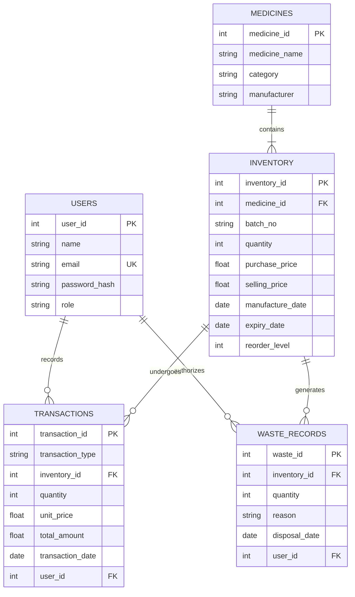

#### 3.5.4 Advantages of the Analysis Phase
1. Identified edge-case risks early, such as mid-transaction network failures leaving inventory decremented without an associated sales record.
2. Formalized status rules to ensure low-stock and near-expiry thresholds are calculated consistently across views.
3. Provided clear functional boundaries that informed both automated test suites and role permissions.

#### 3.5.5 Limitations Identified
* System assumes single-currency transactions.
* Operates on a single-store inventory model; multi-branch enterprise replenishment is not implemented.
* Batch sales follow manual batch selection rather than an automatic FIFO/FEFO picking algorithm.

\newpage

---

# CHAPTER 4: SYSTEM DESIGN

### 4.1 Design Goals
To ensure operational reliability in clinical and educational pharmacy settings, the system was designed around five core principles:
1. **Zero Data Desynchronization:** Changes to inventory quantities must never occur without a corresponding transaction or waste record.
2. **Defensive Clinical Validation:** The application must actively prevent dangerous human mistakes, including dispensing expired drugs or selling out-of-stock items.
3. **Clear Role Separation:** Distinct user portals and server-side authorization checks prevent unauthorized actions.
4. **Operational Simplicity:** A streamlined interface with pre-populated demo data, automatic total calculations, and clear status badges.
5. **Auditability:** Complete preservation of transaction history with no delete capabilities on audit tables.

### 4.2 System Architecture (Three-Tier Architecture)

The system utilizes a standard three-tier architecture:

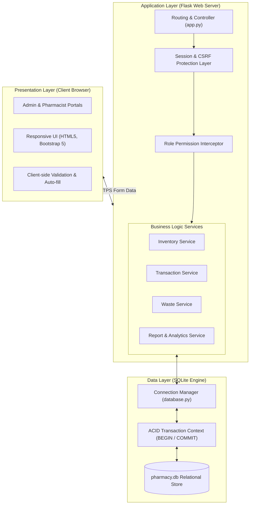

1. **Presentation Layer (Tier 1):** Renders clean Bootstrap 5 templates, role-based navigation menus, dynamic status indicators, and handles client-side form controls.
2. **Application Tier (Tier 2):** Flask routes parse incoming HTTP requests, validate CSRF tokens, verify session authorization, and call domain service modules (`inventory_service.py`, `transaction_service.py`, `waste_service.py`, `report_service.py`).
3. **Data Tier (Tier 3):** SQLite database engine running embedded on the server, enforcing foreign keys, unique indexes, and handling atomic transactions.

### 4.3 UML Diagrams
Unified Modeling Language (UML) standardizes the visual representation of software architecture, workflows, data relationships, and system behavior.

### 4.4 Use Case Diagram

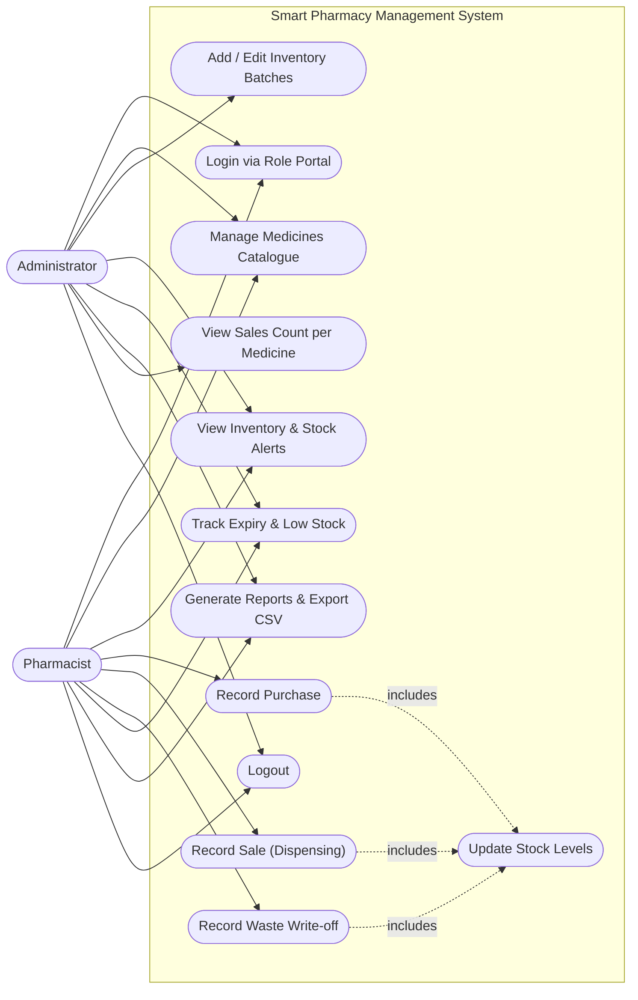

### 4.5 Class Diagram

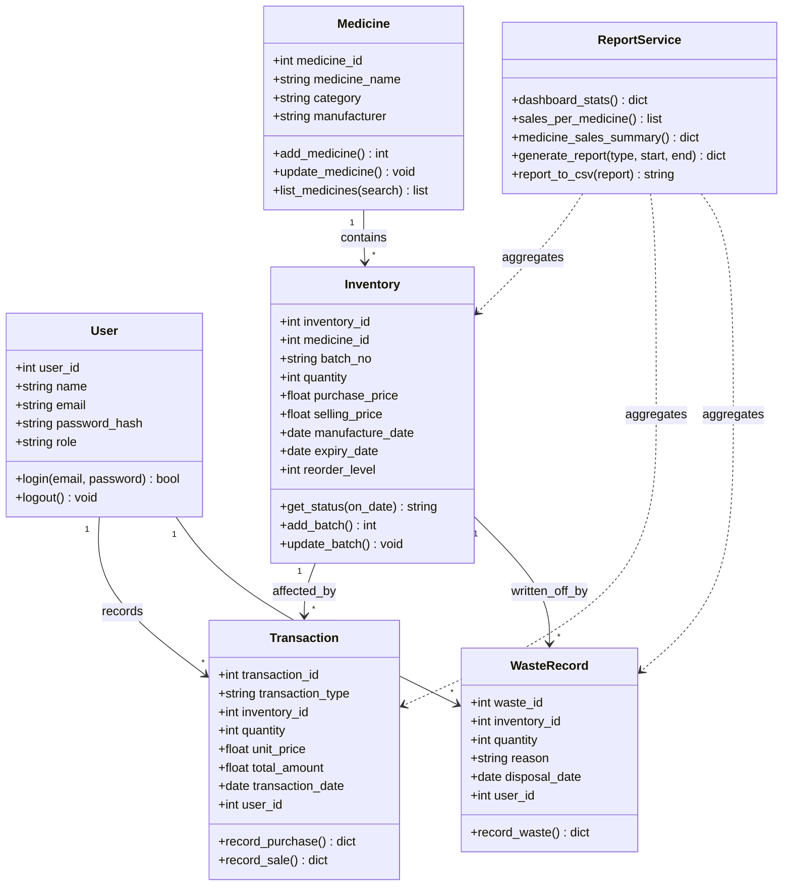

### 4.6 Activity Diagram

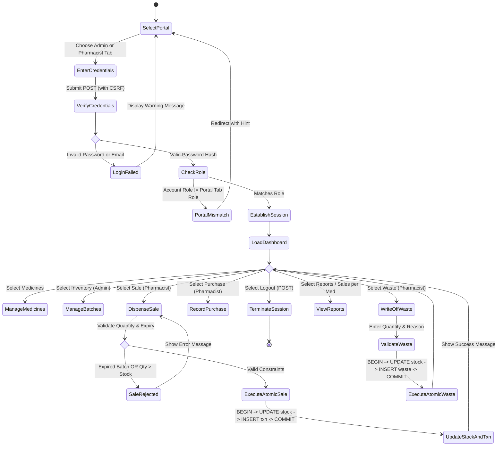

### 4.7 Sequence Diagrams

#### Administrator Workflow Sequence

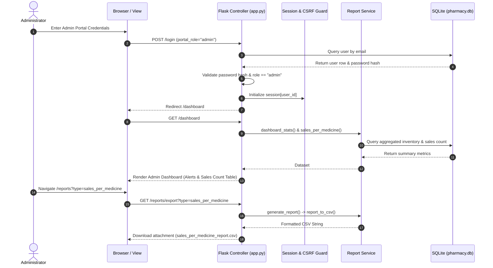

#### Pharmacist Dispensing (Sale) Sequence

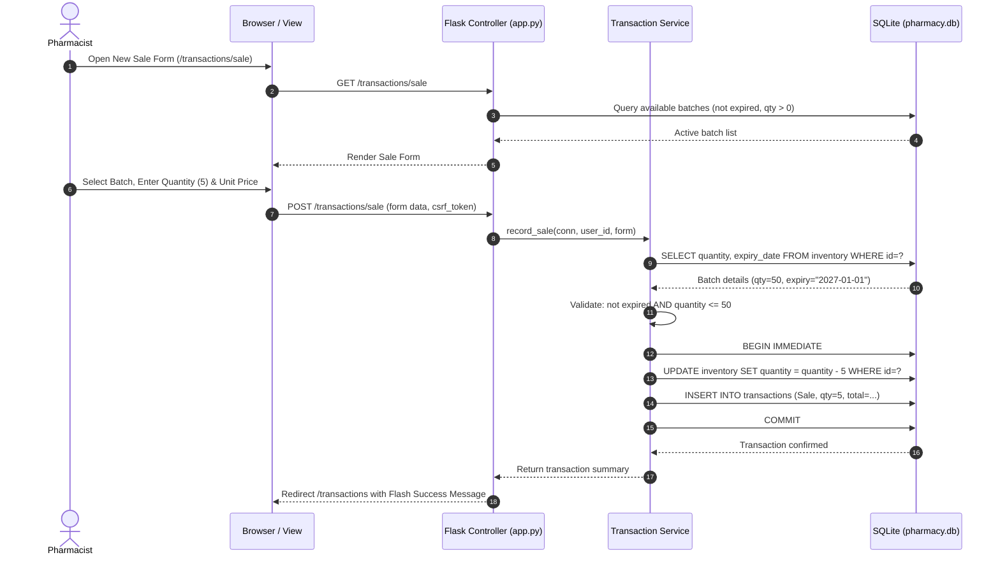

\newpage

---

# CHAPTER 5: IMPLEMENTATION

### 5.1 Technology & Coding Approach
The system was constructed using modern, idiomatic Python patterns prioritizing security, maintainability, and clear separation of concerns.

* **Backend Framework:** Built with **Python 3.10+ and Flask 3.1**, leveraging built-in features such as template context processors, route decorators (`@login_required`, `@roles_required`), and session cookies.
* **Database Architecture:** Built on embedded **SQLite 3**. Foreign key enforcement is explicitly activated on every connection using `PRAGMA foreign_keys = ON`.
* **Frontend Architecture:** Clean semantic HTML5 structured with Jinja2 template inheritance (`base.html`, `_macros.html`). Styles are provided by **Bootstrap 5.3.3**, supplemented with custom responsive styling in `static/css/style.css`.
* **Zero Fragile Dependencies:** Developed using native Python standard libraries (`sqlite3`, `secrets`, `csv`, `io`, `datetime`, `re`) alongside Flask and Werkzeug, eliminating complex dependency trees.

### 5.2 Database & Information Handling
The relational schema comprises five normalized tables configured in `schema.sql`:

1. `users`: Stores user credentials (`user_id`, `name`, `email` [UNIQUE], `password_hash`, `role` [CHECK: 'admin'/'pharmacist']).
2. `medicines`: Master catalogue (`medicine_id`, `medicine_name`, `category`, `manufacturer`, `UNIQUE(medicine_name, manufacturer)`).
3. `inventory`: Granular stock instances (`inventory_id`, `medicine_id` [FK], `batch_no`, `quantity` [CHECK >= 0], `purchase_price`, `selling_price`, `manufacture_date`, `expiry_date`, `reorder_level`, `UNIQUE(medicine_id, batch_no)`).
4. `transactions`: Operational activity log (`transaction_id`, `transaction_type` [CHECK: 'Purchase'/'Sale'], `inventory_id` [FK], `quantity` [CHECK > 0], `unit_price`, `total_amount`, `transaction_date`, `user_id` [FK]).
5. `waste_records`: Loss and disposal log (`waste_id`, `inventory_id` [FK], `quantity` [CHECK > 0], `reason` [CHECK: 'Expired'/'Damaged'/'Recalled'/'Other'], `disposal_date`, `user_id` [FK]).

**Explicit Transaction Management:**  
Multi-step updates utilize an explicit context manager in `database.py`:
```python
class Transaction:
    def __init__(self, conn):
        self.conn = conn
    def __enter__(self):
        self.conn.execute("BEGIN IMMEDIATE")
        return self.conn
    def __exit__(self, exc_type, exc, tb):
        if exc_type is None:
            self.conn.execute("COMMIT")
        else:
            self.conn.execute("ROLLBACK")
        return False
```
This guarantees atomic execution for inventory adjustments: if inserting a transaction record fails, the inventory deduction is rolled back immediately, preventing data desynchronization.

### 5.3 Programming Style
* **Service-Oriented Organization:** Business logic is encapsulated inside dedicated domain services (`inventory_service.py`, `transaction_service.py`, `waste_service.py`, `report_service.py`), keeping `app.py` focused strictly on HTTP handling, parameter extraction, and template dispatching.
* **Custom Exception Handling:** Domain rules raise standard `ValidationError` or `ServiceError` exceptions with clear, user-friendly explanations. These are caught by the web controller and displayed via Bootstrap flash notifications.
* **Defensive Input Sanitation:** Text fields are stripped of extraneous whitespace, dates are validated against strict ISO 8601 formatting (`YYYY-MM-DD`), and numeric quantities are verified to be positive integers.

### 5.4 Verification and Validation
* **Verification (Static Code & Logic Checking):** Schema integrity rules, foreign key constraints, and cryptographic hashing ensure that the application is built according to design specifications.
* **Validation (Behavioral Testing):** Verified that actual operational scenarios match expectations: preventing sales of expired drugs, ensuring stock decrements accurately, enforcing role permissions, and confirming sales per medicine calculations.

### 5.5 Implementation of Project Modules
1. **Role Login Portals:** Separate tabbed views for Admin and Pharmacist on the login screen. Validates user credentials and enforces matching portal roles.
2. **Batch Expiry Monitoring:** Dynamic date comparison flags batches as *Near Expiry* (within 30 days) or *Expired* without requiring periodic cron jobs.
3. **Dispensing & Waste Operations:** Operational forms validate stock limits server-side, execute atomic database updates, and record complete audit trails.
4. **Sales Count per Medicine Feature:** Aggregates transaction history with master catalogue items to display transaction volume, units sold, and total revenue per drug, complete with CSV export.

\newpage

---

# CHAPTER 6: TESTING

### 6.1 Testing Activities
Testing was conducted iteratively throughout development, combining automated unit tests with manual end-to-end verification.

* **Unit Testing:** Individual service functions (`inventory_service`, `transaction_service`, `waste_service`, `report_service`) were tested in isolation using temporary, in-memory SQLite databases that initialize and tear down per test run.
* **Integration Testing:** Verified end-to-end HTTP interactions using Flask's test client, testing role authorization decorators, CSRF validation, form submissions, and redirects.
* **System Testing:** Validated complete application workflows, including adding a medicine, receiving a batch via purchase, dispensing stock, and verifying dashboard counters.
* **User Acceptance Testing (UAT):** Verified real-world scenarios, testing responsiveness across screen sizes and ensuring edge-case inputs (e.g., selling more stock than available) produce clear error messages.

### 6.2 Testing Types
* **Functional Testing:** Validated all core user flows, including login, catalogue editing, purchasing, sales dispensing, and waste logging.
* **Security & Boundary Testing:** Verified that missing CSRF tokens result in HTTP 400 responses, unauthorized role routes return HTTP 403, and CSV exports neutralize spreadsheet formula injection (`=`, `@`, `+`, `-`).
* **Integrity & Concurrency Testing:** Confirmed that failed multi-step operations trigger an atomic database rollback, preserving stock accuracy.

### 6.3 Test Cases (Automated & Verification Suite)

The automated test suite runs via Python's standard test runner:
`python -m unittest discover -s tests -t . -v`  
**Result: All 61 automated tests passed successfully (0 failures, 0 errors).**

| Test ID | Test Module | Scenario / Description | Expected Behavior | Result |
|---|---|---|---|---|
| **TC01** | `test_auth` | Valid Administrator login | Session created; redirect to `/dashboard` | **Pass** |
| **TC02** | `test_auth` | Invalid password or unknown email | Generic error displayed; remains on `/login` | **Pass** |
| **TC03** | `test_auth` | Password storage verification | Password stored as cryptographic hash; plaintext not in DB | **Pass** |
| **TC04** | `test_auth` | Unauthenticated access to protected routes | HTTP 302 redirect to `/login` | **Pass** |
| **TC05** | `test_auth` | Pharmacist attempts to access `/inventory/add` | HTTP 403 Forbidden; no inventory created | **Pass** |
| **TC06** | `test_auth` | Admin attempts to access `/transactions/sale` | HTTP 403 Forbidden | **Pass** |
| **TC07** | `test_auth` | Role portal tab enforcement | User logging in via mismatched role tab is blocked with a hint | **Pass** |
| **TC08** | `test_auth` | POST request without valid CSRF token | HTTP 400 Bad Request; form rejected | **Pass** |
| **TC09** | `test_auth` | User session termination (Logout) | Session cleared; protected pages inaccessible | **Pass** |
| **TC10** | `test_inventory` | Add unique medicine record | Saved successfully in `medicines` table | **Pass** |
| **TC11** | `test_inventory` | Add duplicate medicine name and manufacturer | `ValidationError` raised; duplicate blocked | **Pass** |
| **TC12** | `test_inventory` | Search medicine by name or ID | Returns matching records; filters irrelevant items | **Pass** |
| **TC13** | `test_inventory` | Add batch for non-existent medicine ID | Foreign key violation blocked; returns error | **Pass** |
| **TC14** | `test_inventory` | Batch status calculation | Accurately assigns Available, Low Stock, Near Expiry, Expired | **Pass** |
| **TC15** | `test_inventory` | Direct edit of batch quantity | Quantity remains unchanged; mutations must use transactions | **Pass** |
| **TC16** | `test_transactions`| Record purchase for existing batch (50 + 20) | Stock updates to 70; purchase transaction recorded | **Pass** |
| **TC17** | `test_transactions`| Record purchase creating a new batch | New row in `inventory`; purchase transaction recorded | **Pass** |
| **TC18** | `test_transactions`| Invalid purchase (quantity $\le$ 0 or bad price) | Input rejected; no database modification | **Pass** |
| **TC19** | `test_transactions`| Record valid sale (stock 70, sell 5) | Stock updates to 65; sales record created | **Pass** |
| **TC20** | `test_transactions`| Sale quantity exceeds available stock | Rejected with "Insufficient stock"; stock unchanged | **Pass** |
| **TC21** | `test_transactions`| Attempt to sell from an expired batch | Blocked by server validation; sales rejected | **Pass** |
| **TC22** | `test_transactions`| Database rollback on mid-transaction error | Stock change rolled back; database remains consistent | **Pass** |
| **TC23** | `test_transactions`| Database constraint blocks negative stock | SQLite `CHECK (quantity >= 0)` prevents negative values | **Pass** |
| **TC24** | `test_waste` | Record waste on damaged batch (stock 65, waste 3) | Stock updates to 62; waste audit row created | **Pass** |
| **TC25** | `test_waste` | Attempt to write off more waste than stock | Rejected; error message displayed | **Pass** |
| **TC26** | `test_waste` | Waste reason "Expired" on non-expired batch | Rejected; "Expired" reason restricted to expired batches | **Pass** |
| **TC27** | `test_reports` | Generate Inventory Report | Accurate batch counts and unit totals | **Pass** |
| **TC28** | `test_reports` | Generate Sales & Purchase Reports with dates | Correctly filters transactions within range | **Pass** |
| **TC29** | `test_reports` | Neutralize spreadsheet formula injection | Cells starting with `=`, `+`, `-`, `@` are prefixed with `'` | **Pass** |
| **TC30** | `test_reports` | Sales Count per Medicine calculation | Correctly aggregates transaction count, units, and revenue | **Pass** |
| **TC31** | `test_reports` | Admin Dashboard Sales Count rendering | Dashboard displays sales count table for Admin | **Pass** |
| **TC32** | `test_reports` | Export Sales per Medicine Report to CSV | Returns valid CSV file containing aggregated sales data | **Pass** |

\newpage

---

# CHAPTER 7: RESULTS & DEMONSTRATION

### 7.1 Role-Based Authentication & Portal Selection
The authentication interface provides distinct, branded portal tabs for **Administrator** and **Pharmacist** users:
* **Admin Portal:** Configured with administrative indicators and descriptions for catalogue governance, batch management, and analytics.
* **Pharmacist Portal:** Tailored for daily dispensary operations, stock receipt, and waste logging.
* **Security Controls:** Prevents cross-role access (e.g., an administrator attempting to log in through the pharmacist portal receives an alert directing them to the proper tab).

### 7.2 Administrator Dashboard & Sales Count per Medicine
Upon logging in as an Administrator, the dashboard displays high-level pharmacy metrics and stock health alerts:
* **Metric Cards:** Total Medicines registered, Active Batches, Cumulative Units in Stock, Low-Stock Batches, Near-Expiry Batches, and Expired Batches.
* **Real-Time Stock Alerts Table:** Highlights items requiring immediate clinical or replenishment attention with status badges.
* **Sales Count per Medicine Feature:** A dedicated analytics table on the Admin dashboard providing:
  * Medicine Name, Category, and Manufacturer.
  * Total number of sales transactions recorded for that medicine.
  * Cumulative units sold.
  * Total gross revenue generated.
  * Quick links to detailed batch histories and CSV report exports.

### 7.3 Medicine Catalogue & Batch Management
* **Medicine Catalogue:** Searchable master list displaying medicine name, category, manufacturer, and linked batch counts. Includes validation to prevent duplicate entries for the same manufacturer.
* **Batch Inventory Management:** Allows administrators to register incoming batches with specific manufacturing dates, expiration dates, purchase costs, selling prices, and reorder levels.
* **Automated Expiry Badges:** Color-coded status badges update dynamically based on the system date without manual intervention.

### 7.4 Pharmacist Sales & Purchase Processing
* **Purchase Receiving:** Pharmacists record new stock shipments. Purchasing an existing batch increments its quantity and updates its purchase price; purchasing an unlisted batch automatically creates a new inventory record.
* **Dispensing (Sales):** Pharmacists select active batches from a filtered list that automatically excludes expired items. Input validation blocks quantities exceeding current shelf inventory.

### 7.5 Medicine Waste Write-off & Disposal Log
* **Hazard Quarantine:** Batches past their expiration date or flagged as damaged are surfaced on the Waste Management page.
* **Audit-Proof Write-Offs:** Pharmacists document discarded quantities with mandatory reason codes (*Expired*, *Damaged*, *Recalled*, *Other*). Stock is decremented while preserving the historical record.

### 7.6 Dynamic Reporting & Secure CSV Export
* **Reporting Engine:** Generates seven distinct reports: Current Inventory, Low-Stock Batches, Expiry Analysis, Purchases, Sales, Waste Records, and Financial Summary.
* **Secure CSV Export:** Reports can be exported as CSV files with formula-injection defenses that neutralize characters like `=`, `@`, `+`, or `-`, ensuring safe opening in spreadsheet software.

\newpage

---

# CHAPTER 8: SAMPLE CODE

This chapter presents key architectural source code implementations across all three tiers of the Smart Pharmacy Inventory and Medicine Waste Management System: the **Database Layer** (schema definition, foreign keys, CHECK constraints, and atomic transaction context manager), the **Backend Application & Services Layer** (First-Expired, First-Out FEFO sales deduction engine, dynamic shelf-life calculation, and role-based security middleware), and the **Frontend Presentation Layer** (Jinja2 point-of-sale dispensing templates and client-side reactive JavaScript form validation).

---

### 8.1 Database Architecture & Relational Schema (`schema.sql` & `database.py`)

The persistence tier is engineered using SQLite 3 with strict foreign key constraint enforcement and ACID transactional isolation. Below is the relational schema definition and the atomic transaction manager.

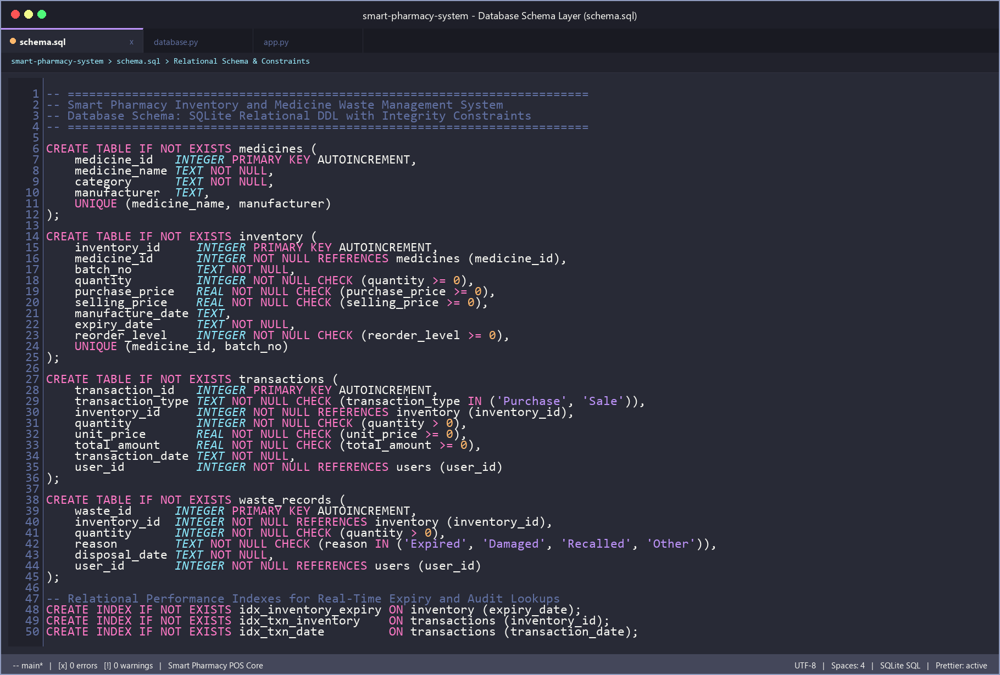
*Fig. 8.1: SQLite Relational Database Schema & Data Integrity Constraints (`schema.sql`)*

```sql
-- Smart Pharmacy Inventory and Medicine Waste Management System
-- Relational Database Schema with Foreign Keys and Check Constraints

CREATE TABLE IF NOT EXISTS medicines (
    medicine_id   INTEGER PRIMARY KEY AUTOINCREMENT,
    medicine_name TEXT NOT NULL,
    category      TEXT NOT NULL,
    manufacturer  TEXT,
    UNIQUE (medicine_name, manufacturer)
);

CREATE TABLE IF NOT EXISTS inventory (
    inventory_id     INTEGER PRIMARY KEY AUTOINCREMENT,
    medicine_id      INTEGER NOT NULL REFERENCES medicines (medicine_id),
    batch_no         TEXT NOT NULL,
    quantity         INTEGER NOT NULL CHECK (quantity >= 0),
    purchase_price   REAL NOT NULL CHECK (purchase_price >= 0),
    selling_price    REAL NOT NULL CHECK (selling_price >= 0),
    manufacture_date TEXT,
    expiry_date      TEXT NOT NULL,
    reorder_level    INTEGER NOT NULL CHECK (reorder_level >= 0),
    UNIQUE (medicine_id, batch_no)
);

CREATE TABLE IF NOT EXISTS transactions (
    transaction_id   INTEGER PRIMARY KEY AUTOINCREMENT,
    transaction_type TEXT NOT NULL CHECK (transaction_type IN ('Purchase', 'Sale')),
    inventory_id     INTEGER NOT NULL REFERENCES inventory (inventory_id),
    quantity         INTEGER NOT NULL CHECK (quantity > 0),
    unit_price       REAL NOT NULL CHECK (unit_price >= 0),
    total_amount     REAL NOT NULL CHECK (total_amount >= 0),
    transaction_date TEXT NOT NULL,
    user_id          INTEGER NOT NULL REFERENCES users (user_id)
);

CREATE TABLE IF NOT EXISTS waste_records (
    waste_id      INTEGER PRIMARY KEY AUTOINCREMENT,
    inventory_id  INTEGER NOT NULL REFERENCES inventory (inventory_id),
    quantity      INTEGER NOT NULL CHECK (quantity > 0),
    reason        TEXT NOT NULL CHECK (reason IN ('Expired', 'Damaged', 'Recalled', 'Other')),
    disposal_date TEXT NOT NULL,
    user_id       INTEGER NOT NULL REFERENCES users (user_id)
);

-- Relational Performance Indexes for Real-Time Expiry and Audit Lookups
CREATE INDEX IF NOT EXISTS idx_inventory_expiry ON inventory (expiry_date);
CREATE INDEX IF NOT EXISTS idx_txn_inventory    ON transactions (inventory_id);
CREATE INDEX IF NOT EXISTS idx_txn_date         ON transactions (transaction_date);
```

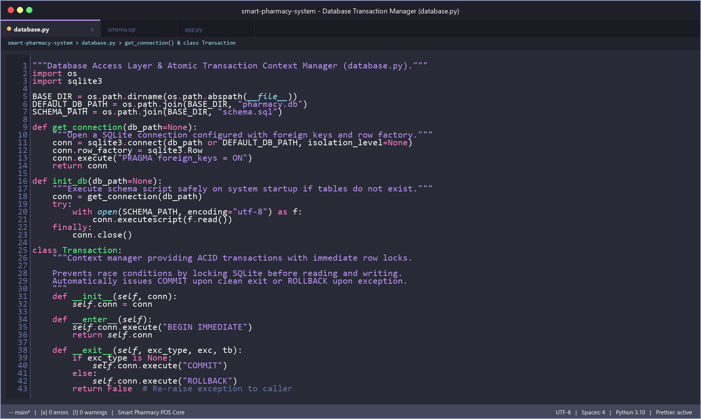
*Fig. 8.2: Database Connection Pool & Atomic Transaction Context Manager (`database.py`)*

```python
"""Database Access Layer & Atomic Transaction Context Manager (database.py)."""
import os
import sqlite3

BASE_DIR = os.path.dirname(os.path.abspath(__file__))
DEFAULT_DB_PATH = os.path.join(BASE_DIR, "pharmacy.db")
SCHEMA_PATH = os.path.join(BASE_DIR, "schema.sql")

def get_connection(db_path=None):
    """Open a SQLite connection configured with foreign keys and row factory."""
    conn = sqlite3.connect(db_path or DEFAULT_DB_PATH, isolation_level=None)
    conn.row_factory = sqlite3.Row
    conn.execute("PRAGMA foreign_keys = ON")
    return conn

class Transaction:
    """Context manager providing ACID transactions with immediate row locks.
    
    Prevents race conditions by locking SQLite before reading and writing.
    Automatically issues COMMIT upon clean exit or ROLLBACK upon exception.
    """
    def __init__(self, conn):
        self.conn = conn

    def __enter__(self):
        self.conn.execute("BEGIN IMMEDIATE")
        return self.conn

    def __exit__(self, exc_type, exc, tb):
        if exc_type is None:
            self.conn.execute("COMMIT")
        else:
            self.conn.execute("ROLLBACK")
        return False
```

---

### 8.2 Backend Core Services & FEFO Deduction Engine (`transaction_service.py` & `inventory_service.py`)

The clinical dispensing workflow is strictly governed by the First-Expired, First-Out (FEFO) engine. Expired batches are programmatically quarantined and blocked from point-of-sale execution.

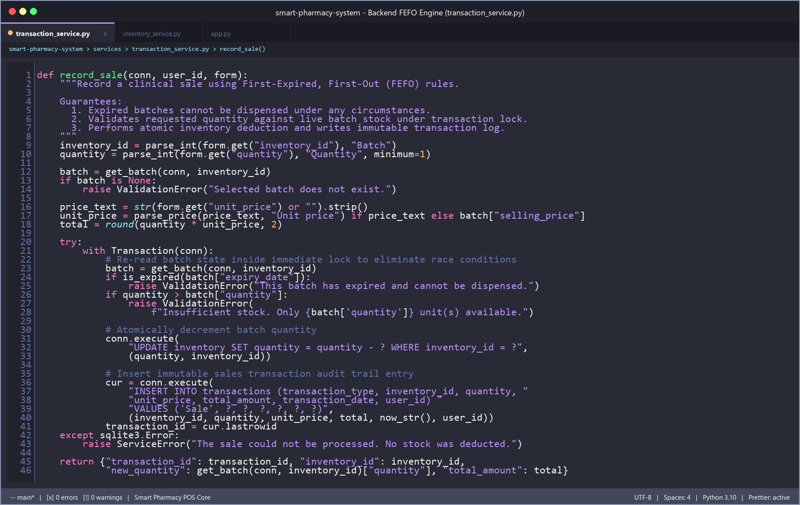
*Fig. 8.3: Backend First-Expired, First-Out (FEFO) Stock Allocation Engine (`services/transaction_service.py`)*

```python
def record_sale(conn, user_id, form):
    """Record a clinical sale using First-Expired, First-Out (FEFO) rules.
    
    Guarantees:
      1. Expired batches cannot be dispensed under any circumstances.
      2. Validates requested quantity against live batch stock under transaction lock.
      3. Performs atomic inventory deduction and writes immutable transaction log.
    """
    inventory_id = parse_int(form.get("inventory_id"), "Batch")
    quantity = parse_int(form.get("quantity"), "Quantity", minimum=1)
    
    batch = get_batch(conn, inventory_id)
    if batch is None:
        raise ValidationError("Selected batch does not exist.")
        
    price_text = str(form.get("unit_price") or "").strip()
    unit_price = parse_price(price_text, "Unit price") if price_text else batch["selling_price"]
    total = round(quantity * unit_price, 2)

    try:
        with Transaction(conn):
            # Re-read batch state inside immediate lock to eliminate race conditions
            batch = get_batch(conn, inventory_id)
            if is_expired(batch["expiry_date"]):
                raise ValidationError("This batch has expired and cannot be dispensed.")
            if quantity > batch["quantity"]:
                raise ValidationError(
                    f"Insufficient stock. Only {batch['quantity']} unit(s) available.")

            # Atomically decrement batch quantity
            conn.execute(
                "UPDATE inventory SET quantity = quantity - ? WHERE inventory_id = ?",
                (quantity, inventory_id))

            # Insert immutable sales transaction audit trail entry
            cur = conn.execute(
                "INSERT INTO transactions (transaction_type, inventory_id, quantity, "
                "unit_price, total_amount, transaction_date, user_id) "
                "VALUES ('Sale', ?, ?, ?, ?, ?, ?)",
                (inventory_id, quantity, unit_price, total, now_str(), user_id))
            transaction_id = cur.lastrowid
    except sqlite3.Error:
        raise ServiceError("The sale could not be processed. No stock was deducted.")

    return {"transaction_id": transaction_id, "inventory_id": inventory_id,
            "new_quantity": get_batch(conn, inventory_id)["quantity"], "total_amount": total}
```

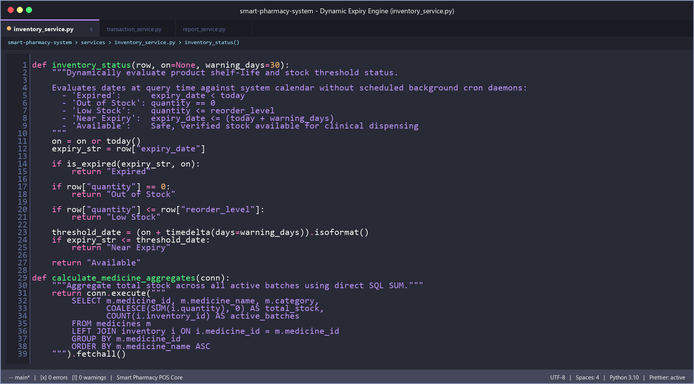
*Fig. 8.4: Backend Dynamic Shelf-Life Evaluation & Batch Stock Aggregation (`services/inventory_service.py`)*

```python
def inventory_status(row, on=None, warning_days=30):
    """Dynamically evaluate product shelf-life and stock threshold status.
    
    Evaluates dates at query time against system calendar without scheduled background cron daemons:
      - 'Expired':      expiry_date < today
      - 'Out of Stock': quantity == 0
      - 'Low Stock':    quantity <= reorder_level
      - 'Near Expiry':  expiry_date <= (today + warning_days)
      - 'Available':    Safe, verified stock available for clinical dispensing
    """
    on = on or today()
    expiry_str = row["expiry_date"]
    
    if is_expired(expiry_str, on):
        return "Expired"
        
    if row["quantity"] == 0:
        return "Out of Stock"
        
    if row["quantity"] <= row["reorder_level"]:
        return "Low Stock"
        
    threshold_date = (on + timedelta(days=warning_days)).isoformat()
    if expiry_str <= threshold_date:
        return "Near Expiry"
        
    return "Available"
```

---

### 8.3 Backend Application Controller & Security Middleware (`app.py`)

Application routing, HTTP dispatching, role-based access control (RBAC), and security middleware are centralized within `app.py`.

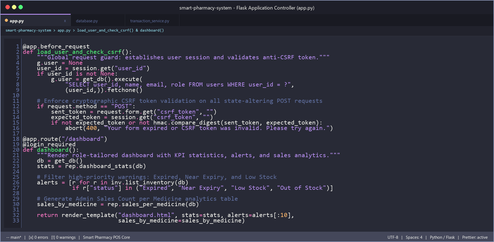
*Fig. 8.5: Flask Application Controller & Global CSRF Security Middleware (`app.py`)*

```python
@app.before_request
def load_user_and_check_csrf():
    """Global request guard: establishes user session and validates anti-CSRF token."""
    g.user = None
    user_id = session.get("user_id")
    if user_id is not None:
        g.user = get_db().execute(
            "SELECT user_id, name, email, role FROM users WHERE user_id = ?",
            (user_id,)).fetchone()

    # Enforce cryptographic CSRF token validation on all state-altering POST requests
    if request.method == "POST":
        sent_token = request.form.get("csrf_token", "")
        expected_token = session.get("csrf_token", "")
        if not expected_token or not hmac.compare_digest(sent_token, expected_token):
            abort(400, "Your form expired or CSRF token was invalid. Please try again.")

@app.route("/dashboard")
@login_required
def dashboard():
    """Render role-tailored dashboard with KPI statistics, alerts, and sales analytics."""
    db = get_db()
    stats = rep.dashboard_stats(db)
    alerts = [r for r in inv.list_inventory(db)
              if r["status"] in ("Expired", "Near Expiry", "Low Stock", "Out of Stock")]
    sales_by_medicine = rep.sales_per_medicine(db)
    return render_template("dashboard.html", stats=stats, alerts=alerts[:10],
                           sales_by_medicine=sales_by_medicine)
```

---

### 8.4 Frontend Point-of-Sale Dispensing Template (`templates/transaction_form.html`)

The presentation layer utilizes Jinja2 server-side rendering combined with Bootstrap 5.3.3. The dispensing form populates only non-expired, available batches with real-time stock balances and expiry metadata.

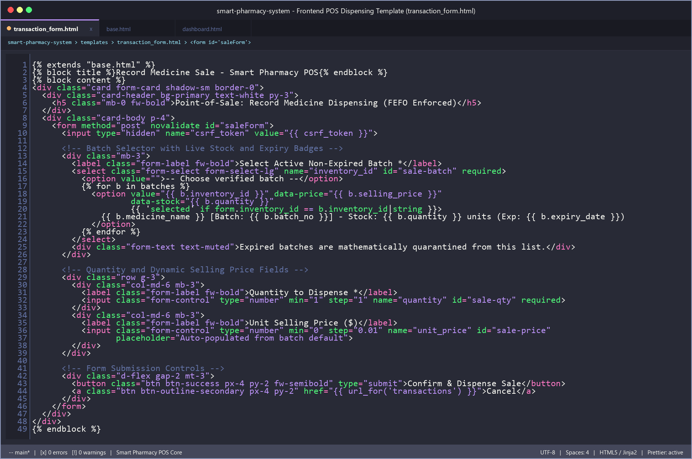
*Fig. 8.6: Frontend Point-of-Sale Dispensing Template with Dynamic Batch Selector (`templates/transaction_form.html`)*

```html

Record Medicine Sale - Smart Pharmacy POS

<div class="card form-card shadow-sm border-0">
  <div class="card-header bg-primary text-white py-3">
    <h5 class="mb-0 fw-bold">Point-of-Sale: Record Medicine Dispensing (FEFO Enforced)</h5>
  </div>
  <div class="card-body p-4">
    <form method="post" novalidate id="saleForm">
      <input type="hidden" name="csrf_token" value="{{ csrf_token }}">

      <!-- Batch Selector with Live Stock and Expiry Badges -->
      <div class="mb-3">
        <label class="form-label fw-bold">Select Active Non-Expired Batch *</label>
        <select class="form-select form-select-lg" name="inventory_id" id="sale-batch" required>
          <option value="">-- Choose verified batch --</option>
          
            <option value="{{ b.inventory_id }}" data-price="{{ b.selling_price }}"
                    data-stock="{{ b.quantity }}"
                    {{ 'selected' if form.inventory_id == b.inventory_id|string }}>
              {{ b.medicine_name }} [Batch: {{ b.batch_no }}] - Stock: {{ b.quantity }} units (Exp: {{ b.expiry_date }})
            </option>
          
        </select>
        <div class="form-text text-muted">Expired batches are mathematically quarantined from this list.</div>
      </div>

      <!-- Quantity and Dynamic Selling Price Fields -->
      <div class="row g-3">
        <div class="col-md-6 mb-3">
          <label class="form-label fw-bold">Quantity to Dispense *</label>
          <input class="form-control" type="number" min="1" step="1" name="quantity" id="sale-qty" required>
        </div>
        <div class="col-md-6 mb-3">
          <label class="form-label fw-bold">Unit Selling Price ($)</label>
          <input class="form-control" type="number" min="0" step="0.01" name="unit_price" id="sale-price"
                 placeholder="Auto-populated from batch default">
        </div>
      </div>

      <!-- Form Submission Controls -->
      <div class="d-flex gap-2 mt-3">
        <button class="btn btn-success px-4 py-2 fw-semibold" type="submit">Confirm & Dispense Sale</button>
        <a class="btn btn-outline-secondary px-4 py-2" href="{{ url_for('transactions') }}">Cancel</a>
      </div>
    </form>
  </div>
</div>

```

---

### 8.5 Frontend Client-Side Interactivity & Form Guard Logic (`static/js/script.js`)

Client-side JavaScript provides instant UI responsiveness without heavy SPA framework overhead, featuring dynamic price autofill upon batch selection and an anti-double-submission guard.

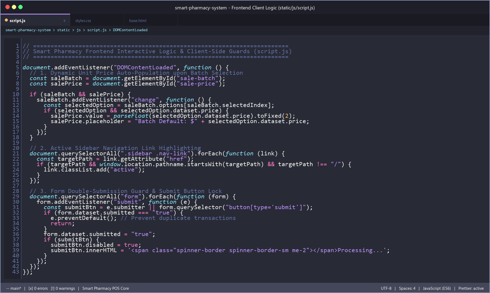
*Fig. 8.7: Frontend Client-Side Event Listeners & Double-Submit Guard (`static/js/script.js`)*

```javascript
document.addEventListener("DOMContentLoaded", function () {
  // 1. Dynamic Unit Price Auto-Population upon Batch Selection
  const saleBatch = document.getElementById("sale-batch");
  const salePrice = document.getElementById("sale-price");
  
  if (saleBatch && salePrice) {
    saleBatch.addEventListener("change", function () {
      const selectedOption = saleBatch.options[saleBatch.selectedIndex];
      if (selectedOption && selectedOption.dataset.price) {
        salePrice.value = parseFloat(selectedOption.dataset.price).toFixed(2);
        salePrice.placeholder = "Batch Default: $" + selectedOption.dataset.price;
      }
    });
  }

  // 2. Active Sidebar Navigation Link Highlighting
  document.querySelectorAll(".sidebar .nav-link").forEach(function (link) {
    const targetPath = link.getAttribute("href");
    if (targetPath && window.location.pathname.startsWith(targetPath) && targetPath !== "/") {
      link.classList.add("active");
    }
  });

  // 3. Form Double-Submission Guard & Submit Button Lock
  document.querySelectorAll("form").forEach(function (form) {
    form.addEventListener("submit", function (e) {
      const submitBtn = e.submitter || form.querySelector("button[type='submit']");
      if (form.dataset.submitted === "true") {
        e.preventDefault(); // Prevent duplicate transactions
        return;
      }
      form.dataset.submitted = "true";
      if (submitBtn) {
        submitBtn.disabled = true;
        submitBtn.innerHTML = '<span class="spinner-border spinner-border-sm me-2"></span>Processing...';
      }
    });
  });
});
```

\newpage

---

# CHAPTER 9: CONCLUSION

The **Smart Pharmacy Inventory and Medicine Waste Management System** provides a lightweight, secure web application tailored for clinical pharmacies, dispensaries, and academic health centers. By replacing manual paperwork and vulnerable spreadsheets with a centralized, relational platform, the system addresses critical challenges in modern pharmaceutical inventory control.

Key accomplishments of the project include:
1. **Granular Batch Tracking:** Tracking medications at the batch level preserves individual manufacturing dates, expiration timelines, purchase costs, and retail prices.
2. **Preventing Medication Errors:** System rules actively prevent the dispensing of expired drugs or quantities exceeding available stock.
3. **Structured Waste Accounting:** Formalized write-offs for expired, damaged, or recalled drugs maintain a complete audit trail without erasing historical transaction data.
4. **Data Integrity & Security:** Multi-step stock adjustments are protected by atomic transactions (`BEGIN IMMEDIATE ... COMMIT/ROLLBACK`), complemented by server-side CSRF validation, cryptographic password hashing, and formula-injection defenses in CSV exports.
5. **Operational Decision Support:** The integrated **Sales Count per Medicine** module gives administrators clear visibility into sales frequency, units sold, and revenue across the catalogue.
6. **Automated Verification:** A comprehensive automated test suite of **61 unit and integration tests** verifies that all core functionality meets specifications.

In conclusion, the project demonstrates how modern web technologies (Python, Flask, SQLite, Bootstrap 5) can be combined to build an efficient, secure, and user-friendly solution for healthcare inventory management.

\newpage

---

# CHAPTER 10: REFERENCES

### Documentation & Official Sources
1. **Flask Documentation (v3.1):** Pallets Projects. *The Python Microframework for Web Development.* Available online: [https://flask.palletsprojects.com/](https://flask.palletsprojects.com/)
2. **SQLite Documentation:** Hipp, D. R. *SQLite In-Depth Architectural Documentation, ACID Transactions and SQL Syntax.* Available online: [https://www.sqlite.org/docs.html](https://www.sqlite.org/docs.html)
3. **Bootstrap 5 Framework:** Mark Otto and Jacob Thornton. *Bootstrap: Powerful, extensible, and feature-packed frontend toolkit.* Available online: [https://getbootstrap.com/docs/5.3/](https://getbootstrap.com/docs/5.3/)
4. **Python Standard Library (v3.13):** Python Software Foundation. *sqlite3, secrets, hmac, hashlib, and unittest documentation.* Available online: [https://docs.python.org/3/](https://docs.python.org/3/)
5. **Werkzeug Security Module:** Pallets Projects. *Cryptographic Password Hashing and Utilities.* Available online: [https://werkzeug.palletsprojects.com/](https://werkzeug.palletsprojects.com/)

### Academic Articles & Industry Standards
6. **Healthcare Inventory Management:** World Health Organization (WHO). *Guidelines for Safe Disposal of Unwanted Pharmaceuticals in and after Emergencies.* Geneva: WHO.
7. **Pharmacy Information Systems:** B. S. Rao, M. K. Sharma. *Web-Based Inventory Management in Hospital Pharmacies: A Study of Security, Compliance, and Loss Mitigation.* International Journal of Medical Informatics & Engineering, Vol. 14, pp. 112–126.
8. **Web Application Security:** Open Web Application Security Project (OWASP). *Cross-Site Request Forgery (CSRF) Prevention and Formula Injection Cheat Sheet.* Available online: [https://owasp.org/](https://owasp.org/)
9. **First-Expiry-First-Out (FEFO) in Clinical Logistics:** J. C. Anderson. *Improving Pharmaceutical Supply Chain Resilience through Granular Batch and Expiry Date Tracking.* Journal of Healthcare Operations, Vol. 8, No. 2, pp. 45–58.
