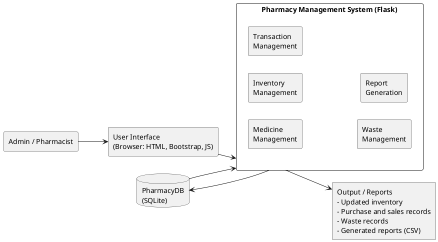
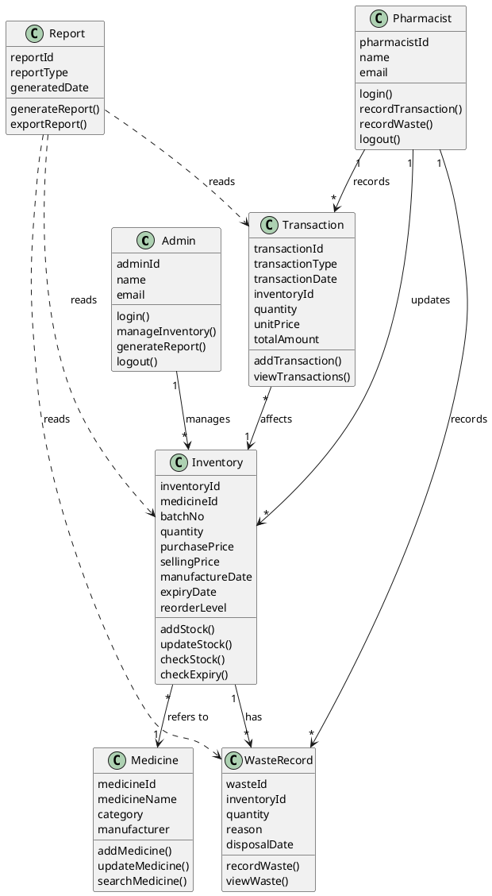
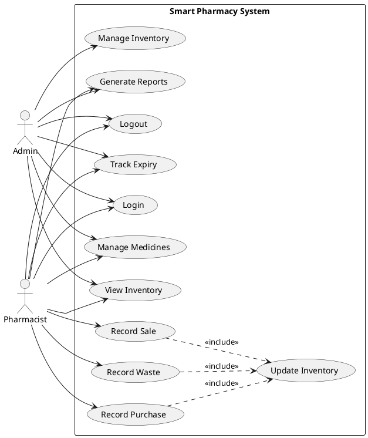
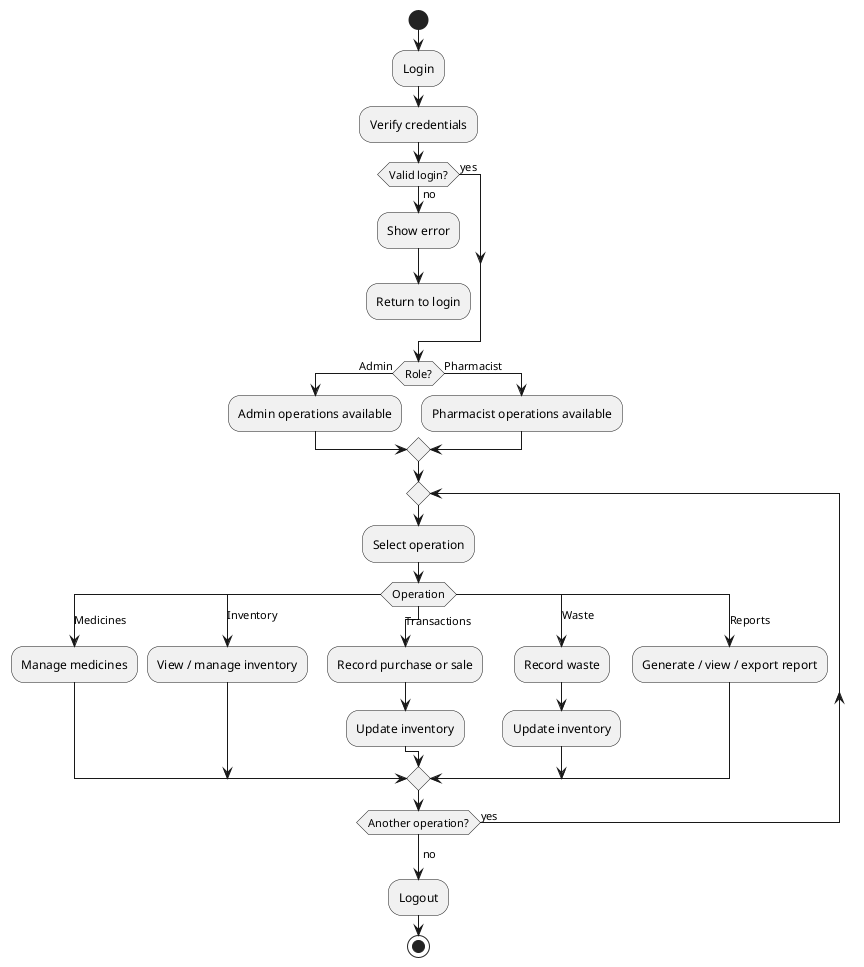
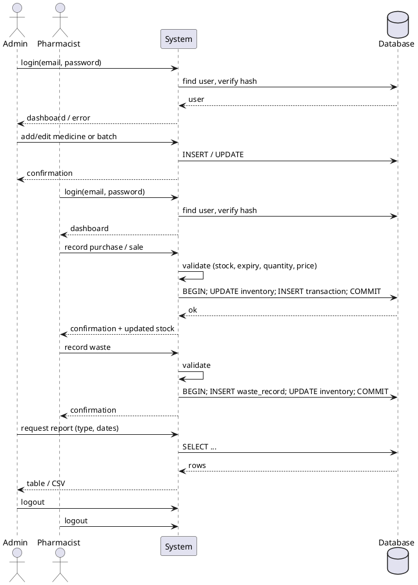
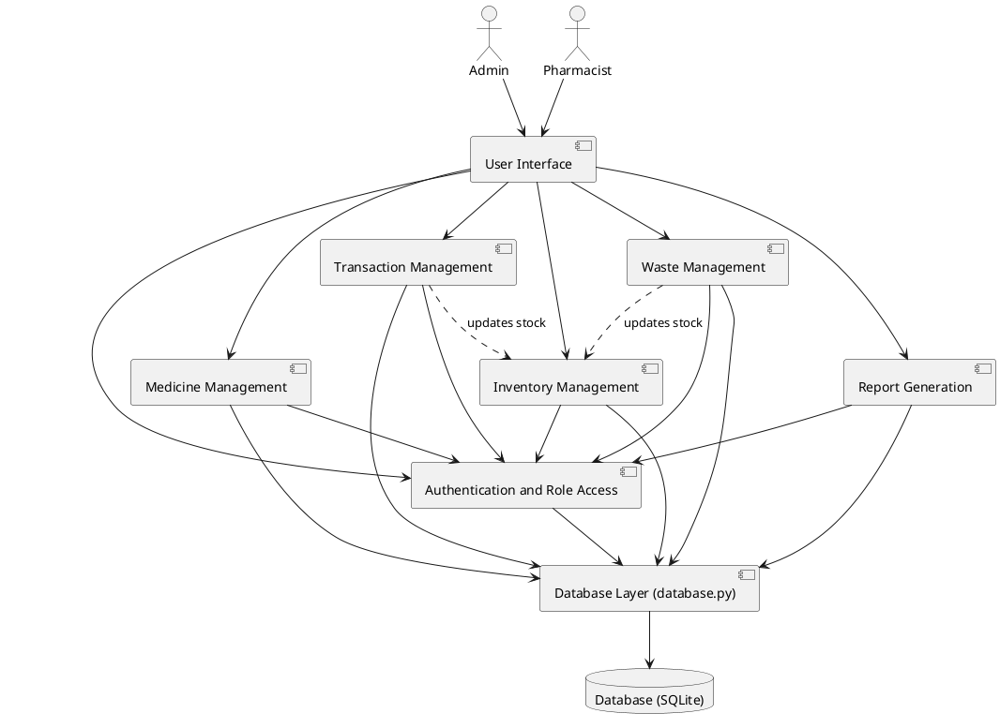
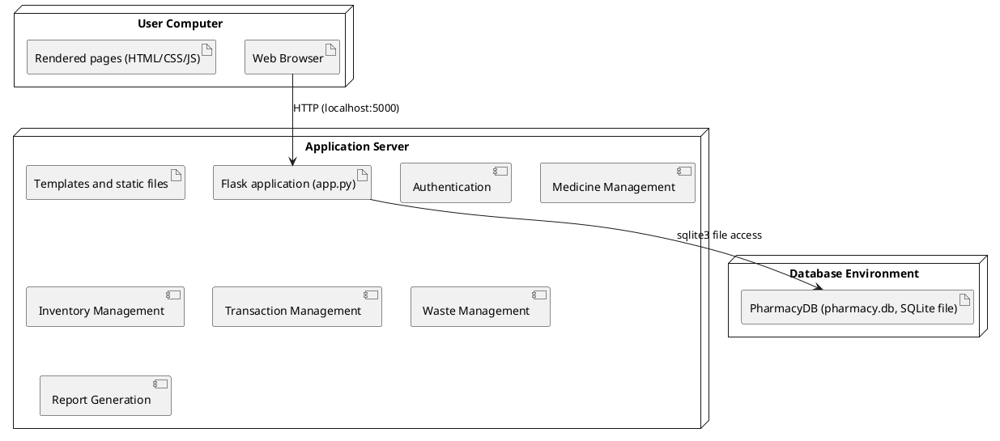
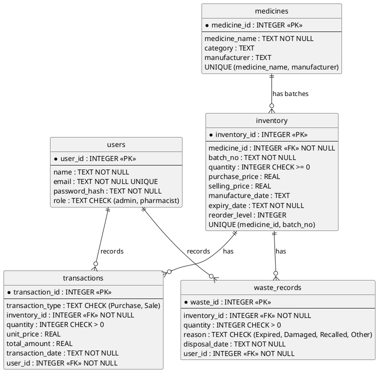

# UML / ER diagrams (PlantUML source)

How to view: install the VS Code extension **PlantUML** (needs Java) and press `Alt+D`, **or** paste a
block (without the code fence) into https://www.plantuml.com/plantuml . Export PNG for your report.
*These were written to match the code and schema but were not rendered by the author; if a diagram does
not render, check the PlantUML syntax version.*

## 1. Block diagram

## 2. Class diagram (seven conceptual classes)

Note: in the code, Admin and Pharmacist are one `users` table with a `role` column. Purchase and Sale are
one `Transaction` class distinguished by `transactionType`.

## 3. Use case diagram

## 4. Activity diagram

## 5. Sequence diagram

## 6. Component diagram

## 7. Deployment diagram

SQLite is an embedded database: no separate database server is needed. When run locally, all three nodes
are the same computer (the Flask process and `pharmacy.db` file sit on the user's machine).

## 8. ER diagram (matches `schema.sql`)

